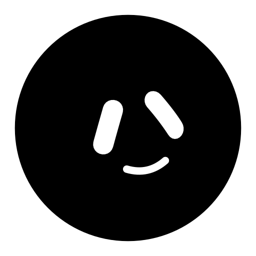

# Circle

An animated mascot with 25 expressions and 40 states, built on the
"Circle" silhouette. Made with Blob Studio.

## What's in here

```
CircleAvatar.tsx        the animated component — React is its only dependency
svg/states/*.svg      40 still frames, one per state
svg/expressions/*.svg  25 still frames, one per expression
svg/sprite.svg        every state as a <symbol>, for plain HTML
manifest.json         states, groups, and which expression each rests on
```

## Using it in React

Copy `CircleAvatar.tsx` into your project. Nothing else is needed.

```tsx
import CircleAvatar from './CircleAvatar';

<CircleAvatar state="thinking" size={160} />;
```

Set `state` and it animates itself: it picks that state's resting face, drifts through the
state's expression pool on its own cadence, blinks on its own rhythm, and moves its body to
match. `CIRCLE_STATES` exports the full list.

Useful props: `expression` pins one face, `lookAround` controls how far the eyes drift from
centre (0 = always facing you), `motion` scales the body animation, `effects` and `glyphs`
switch off confetti/ribbons and the symbol morphs, `gaze` and `turn` aim it manually.

## Using it without React

Plain HTML, via the sprite:

```html
<svg width="96" height="96"><use href="svg/sprite.svg#thinking" /></svg>
```

Or reference a single file directly:

```html

```

These are static — one frame, no animation. For the moving mascot, use the component.

## Licence

The expression geometry originates in Sébastien Montlouis-Calixte's GrokBot prototype
(<https://gist.github.com/smontlouis/49a4c9303de70118a90dc43badc1aba5>), which carries no
explicit licence. Bear that in mind before redistributing this as your own work.
