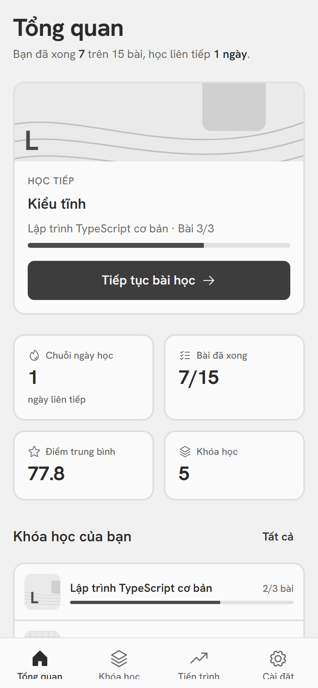
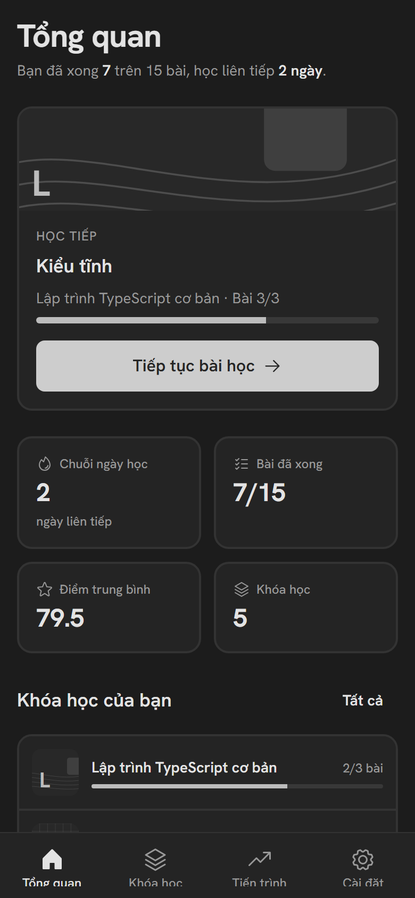
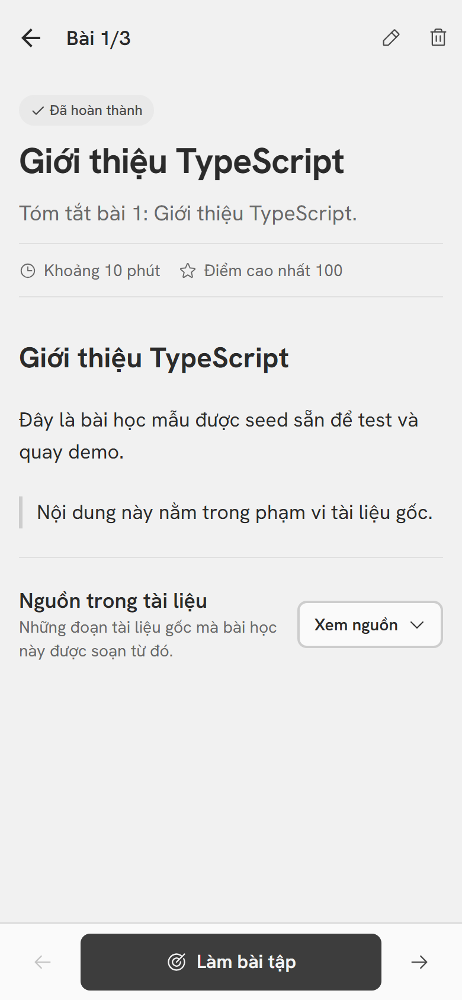
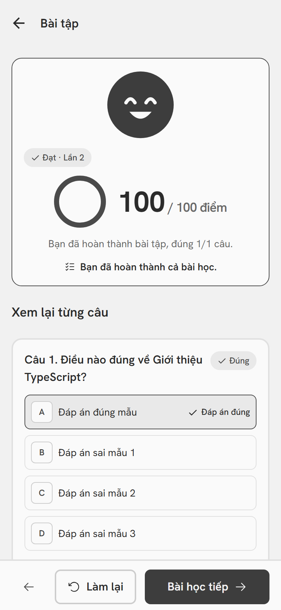
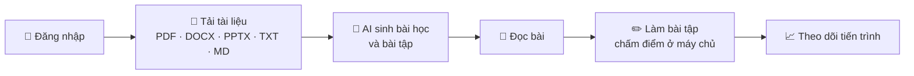

<div align="center">

# 📱 LEARN Mobile

**Biến tài liệu của bạn thành bài học và bài tập tương tác bằng AI — ngay trên điện thoại.**


[Bắt đầu nhanh](#-bắt-đầu-nhanh) ·
[Tính năng](#-tính-năng-hiện-có) ·
[Tài liệu](#-tài-liệu) ·
[API mock](mock-api/README.md) ·
[Đặc tả tính năng mới](docs/requirements/SRS.md)

<br />

| Sáng | Tối | Bài học | Kết quả |
| :---: | :---: | :---: | :---: |
|  |  |  |  |

</div>

---

## 🎯 Dự án này là gì

LEARN Mobile là **nền móng** của ứng dụng di động LEARN. Luồng cơ bản nhất đã chạy được:



Repo này được bàn giao để team **làm lại giao diện** và **xây tiếp các tính năng mới** (flashcard
ôn tập ngắt quãng, Pomodoro, streak/XP, xếp hạng… — xem [SRS](docs/requirements/SRS.md)).

> [!IMPORTANT]
> **Trạng thái: nền móng, đang phát triển.**
> - ✅ Đã kiểm bằng unit test và e2e trên **bản web** (chạy được cả trên API mock).
> - ⚠️ **Chưa** chạy đạt checklist trên điện thoại thật → [testing.md](docs/testing.md#4-checklist-trên-điện-thoại-thật).
> - 🎨 Giao diện hiện tại là bản tạm, đơn sắc dịu ([ADR 001](docs/adr/001-don-sac-diu.md)); team sẽ thiết kế lại.

## 🚀 Bắt đầu nhanh

Không cần Docker, không cần backend, không cần API key.

**Cần:** Node ≥ 20 · Git · [Expo Go](https://expo.dev/go) trên điện thoại (cùng Wi‑Fi với máy tính).

```bash
npm install
npm run mock      # terminal 1 — API giả, cổng 4000
npm start         # terminal 2 — mở app: quét mã QR bằng Expo Go
```

Quét mã QR (Android: trong Expo Go · iPhone: bằng app Camera), rồi đăng nhập:

| Vai trò | Email | Mật khẩu |
| --- | --- | --- |
| Người học | `demo@learn.ai` | `Demo@12345` |
| Quản trị | `admin@learn.ai` | `Admin@12345` |

> [!TIP]
> App tự tìm API ở `<IP máy tính>:4000` nên **không cần cấu hình gì**. Gặp lỗi kết nối? Xem
> [bảng xử lý sự cố](docs/getting-started.md#8-xử-lý-sự-cố).

### Chọn backend: mock hay thật?

App không có backend riêng, mọi dữ liệu đi qua một API. Cả hai lựa chọn đều ở cổng 4000 nên đổi qua
lại không cần cấu hình lại.

| | 🧪 **API mock** *(có sẵn trong repo)* | 🏗️ **Backend thật** |
| --- | --- | --- |
| Dùng khi | Làm giao diện, thử luồng, demo | Kiểm tra tích hợp, AI thật |
| Cần | Chỉ Node | Docker + [LEARN_website](https://github.com/TrKimHieu/LEARN_website) |
| Dữ liệu | Có sẵn, mất khi tắt | Lưu trong Postgres |
| Khởi chạy | `npm run mock` | [getting-started §3B](docs/getting-started.md#3b-cách-b--dựng-backend-thật-repo-learn_website) |

## ✨ Tính năng hiện có

<table>
<tr><th>Nhóm</th><th>Việc làm được</th></tr>
<tr><td><b>🔐 Tài khoản</b></td><td>Đăng nhập · đăng ký · quên / đặt lại mật khẩu (mở từ web bằng <code>learn://</code>). Báo lỗi ngay dưới ô sai; giữ phiên giữa các lần mở app.</td></tr>
<tr><td><b>🏠 Tổng quan</b></td><td>Thẻ "Học tiếp" mở thẳng bài kế tiếp, 4 số liệu, chuỗi ngày học, khóa học, hoạt động gần đây.</td></tr>
<tr><td><b>📚 Khóa học</b></td><td>Danh sách có bìa theo khóa · tạo khóa mới · lộ trình bài học (sắp xếp lên/xuống) · tải tài liệu (PDF/DOCX/PPTX/TXT/MD) với trạng thái trích xuất tự cập nhật · <b>sinh bài bằng AI</b> có chọn độ khó và theo dõi tiến độ trực tiếp.</td></tr>
<tr><td><b>📖 Đọc bài</b></td><td>Nội dung Markdown, mục lục, cảnh báo bài lệch nguồn, đoạn tài liệu gốc, bài trước/sau, sửa và xoá bài.</td></tr>
<tr><td><b>✏️ Bài tập</b></td><td>4 loại câu hỏi · nhiều bài tập mỗi bài · chấm điểm ở máy chủ · xem lại từng câu · làm lại.</td></tr>
<tr><td><b>📈 Tiến trình</b></td><td>Tiến độ theo khóa · lịch sử làm bài phân trang.</td></tr>
<tr><td><b>⚙️ Cài đặt</b></td><td>Hồ sơ · giao diện Sáng/Tối/Tự động · gói đăng ký và hạn mức (demo) · đăng xuất / đăng xuất mọi thiết bị.</td></tr>
<tr><td><b>🛡️ Quản trị</b> <i>(chỉ ADMIN)</i></td><td>Số liệu tổng · chi phí LLM 7 ngày · danh sách AI Job (lọc) · chi tiết · chạy lại job lỗi · nhật ký thao tác.</td></tr>
</table>

Mọi màn có dữ liệu đều xử lý đủ **5 trạng thái**: Đang tải · Trống · Lỗi (kèm mã yêu cầu và nút thử
lại) · Một phần · Thành công.

## 🧰 Công nghệ

| Lớp | Chọn |
| --- | --- |
| Nền tảng | Expo SDK 57 · React Native 0.86 · React 19.2 |
| Ngôn ngữ | TypeScript `strict` + `noUncheckedIndexedAccess` |
| Điều hướng | Expo Router (route theo file, typed routes) |
| Dữ liệu | TanStack Query · Zod (schema chép từ `@learn/contracts`) |
| Bảo mật phiên | `expo-secure-store` (Keychain / Keystore) |
| Giao diện | Hanken Grotesk · Phosphor icons · `react-native-svg` |
| Kiểm thử | Jest (`jest-expo`) · Playwright + axe |

Mọi thư viện đều có sẵn trong **Expo Go**, không cần bản build riêng. Chi tiết:
[docs/architecture.md](docs/architecture.md).

## 🧭 Lệnh thường dùng

| Lệnh | Việc làm |
| --- | --- |
| `npm run mock` | Chạy API mock (cổng 4000) |
| `npm start` | Chạy dev server cho Expo Go |
| `npm run typecheck` | So contracts với LEARN + `tsc --noEmit` |
| `npm run lint` | ESLint |
| `npm test` | Unit test + kiểm API mock khớp contracts |
| `npm run e2e` | E2E Playwright trên bản web *(cần API đang chạy)* |
| `npx expo install <gói>` | Thêm thư viện — **luôn** dùng lệnh này |

Trước khi commit: `npm run typecheck && npm run lint && npm test`. Danh sách đầy đủ và quy trình:
[docs/development.md](docs/development.md).

## 📚 Tài liệu

Mục lục đầy đủ: **[docs/README.md](docs/README.md)**.

| Bạn muốn… | Đọc |
| --- | --- |
| Cài đặt, chạy, xử lý sự cố | [getting-started.md](docs/getting-started.md) |
| Làm giao diện không cần backend | [mock-api/README.md](mock-api/README.md) |
| Hiểu cấu trúc, điều hướng, dữ liệu, phiên | [architecture.md](docs/architecture.md) |
| Viết code đúng quy ước, thêm màn / API | [development.md](docs/development.md) |
| Chạy kiểm thử, test trên điện thoại thật | [testing.md](docs/testing.md) |
| Build APK, phát hành qua EAS | [deployment.md](docs/deployment.md) |
| Xây tính năng mới | [requirements/SRS.md](docs/requirements/SRS.md) |
| Biết vì sao chọn giao diện đơn sắc dịu | [adr/001-don-sac-diu.md](docs/adr/001-don-sac-diu.md) |

## 🗂️ Cấu trúc thư mục

```text
LEARN_mobile/
├─ src/
│  ├─ app/          Route (Expo Router) — mỗi file là một màn
│  ├─ components/   Thành phần dùng chung (ui/, mascot/…)
│  ├─ features/     Hook API + component theo nghiệp vụ
│  ├─ lib/          api-client, token-store, query-client, config…
│  ├─ contracts/    Sinh tự động từ LEARN — không sửa tay
│  └─ theme/        Token màu / chữ / khoảng cách
├─ mock-api/        API giả để làm giao diện không cần backend
├─ docs/            Tài liệu (xem docs/README.md)
├─ e2e/             E2E Playwright + tệp mẫu
└─ scripts/         sync-contracts · gen-icons · gen-circle-data
```
