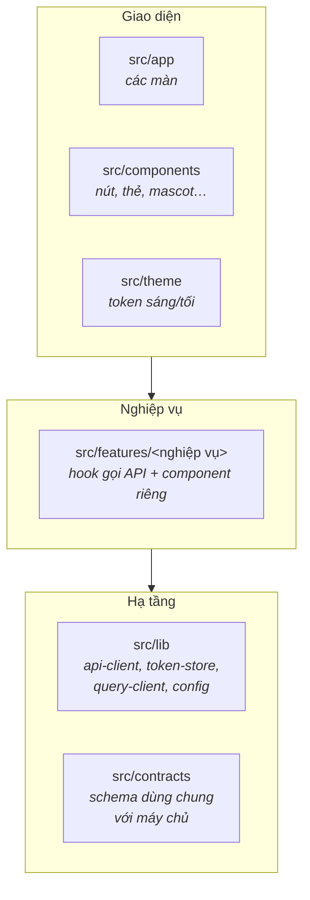
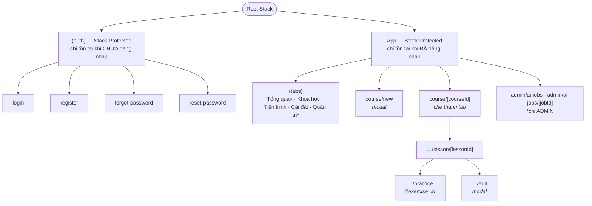
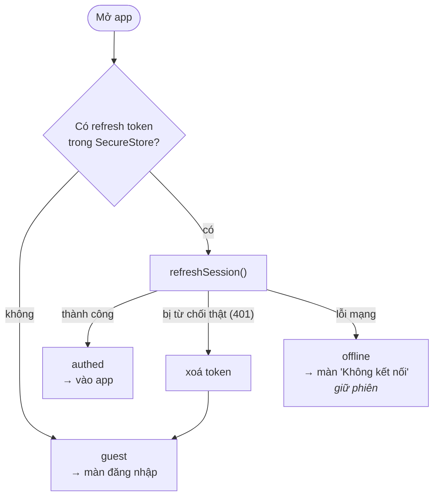

# Kiến trúc của app

> [!NOTE]
> Tài liệu này mô tả app **đang được tổ chức thế nào** và vì sao. Đọc trước khi thêm màn hoặc tính năng mới. Mô tả đầy đủ hơn (kèm sơ đồ tuần tự, máy trạng thái, mô hình dữ liệu) nằm ở
[SRS mục 2 và 9](requirements/SRS.md).

## 1. Công nghệ

| Thành phần | Chọn | Ghi chú |
| --- | --- | --- |
| Nền tảng | Expo SDK 57, React Native 0.86, React 19.2 | Chạy trong Expo Go, không cần bản build riêng |
| Ngôn ngữ | TypeScript `strict` + `noUncheckedIndexedAccess` | Alias `@/` trỏ tới `src/` |
| Điều hướng | Expo Router (route theo file), typed routes | Route nằm trong `src/app/` |
| Dữ liệu từ API | TanStack Query | Cùng query key với bản web |
| Kiểm tra dữ liệu | Zod, schema chép từ `@learn/contracts` | Xem mục 5 |
| Phiên đăng nhập | `expo-secure-store` | Keychain (iOS) / Keystore (Android) |
| Giao diện | Hanken Grotesk, icon Phosphor, `react-native-svg` | Mascot Circle và bìa khóa học là SVG |
| Tài liệu | `expo-document-picker`, `expo-file-system`, `expo-crypto` | SHA-256 + PUT thẳng lên S3/MinIO |
| Kiểm thử | Jest (`jest-expo`); Playwright + axe cho e2e trên bản web | Xem [testing.md](testing.md) |

## 2. Ba lớp



> [!IMPORTANT]
> Quy tắc phụ thuộc: lớp trên được gọi lớp dưới, **không ngược lại**. Màn (`src/app`) chỉ ghép
> component và gọi hook; mọi lời gọi mạng nằm trong hook của `src/features`.

## 3. Cấu trúc thư mục

```
src/
├─ app/                  Route (Expo Router) — mỗi file là một màn
│  ├─ (auth)/            login · register · forgot-password · reset-password
│  ├─ (tabs)/            index · courses · progress · settings · admin
│  ├─ course/            new (modal) · [courseId]/… (chi tiết, bài học, bài tập, sửa)
│  ├─ admin/ai-jobs/     danh sách và chi tiết AI Job (chỉ ADMIN)
│  └─ _layout.tsx        Root Stack, providers, chặn route theo trạng thái đăng nhập
├─ components/           Thành phần dùng chung
│  ├─ ui/                button, field, surface, text, ring, icon, states…
│  └─ mascot/            Mascot Circle (dữ liệu SVG sinh bởi scripts/gen-circle-data.mjs)
├─ features/             auth · courses · documents · learning · ai · settings · admin
├─ lib/                  api-client · token-store · query-client · config · routes · format …
├─ contracts/            SINH TỰ ĐỘNG từ LEARN — không sửa tay
└─ theme/                tokens.ts (màu, chữ, khoảng cách) + ThemeProvider

mock-api/                API giả (Node thuần) để làm giao diện không cần backend — xem mock-api/README.md
```

Thêm vào đây khi tạo thư mục mới. Code không phải route phải nằm **ngoài** `src/app/`.

## 4. Điều hướng



- Chưa đăng nhập thì các route trong app **không tồn tại**. Đăng nhập xong app tự chuyển vào; không
  gọi `router.replace` bằng tay.
- Route **chỉ mang ID** làm tham số. Màn đích tự đọc dữ liệu mới nhất từ query cache hoặc API, không
  truyền cả object qua route.
- Đường dẫn gom ở một chỗ: `src/lib/routes.ts`. Dùng `routes.course(id)` thay vì viết chuỗi.
- Deep link: scheme `learn://`, ví dụ `learn://course/<id>`; đặt lại mật khẩu mở từ trang web bằng
  `learn://reset-password`.

## 5. Dữ liệu và contracts

**Máy chủ là nguồn sự thật.** App không có cơ sở dữ liệu riêng; mọi thứ đọc và ghi qua API của LEARN.

`src/contracts/` là bản chép của `packages/contracts` (Zod schema dùng chung của API và web):

- Sinh bằng `npm run sync:contracts`, kiểm bằng `npm run typecheck` (bước `--check` báo lệch).
- **Không sửa tay.** Muốn đổi schema thì sửa bên LEARN rồi đồng bộ lại.
- Không có repo `../LEARN` bên cạnh thì script dùng bản đã chép và không báo lỗi.
- Đổi nguồn bằng biến môi trường `LEARN_CONTRACTS_DIR`.

Vì sao chép thay vì khai báo dependency `file:../LEARN/...`: app là repo riêng và có thể build ở nơi
không có LEARN. Chép có kiểm soát giữ app tự đứng được.

### Gọi API

Mọi lời gọi đi qua `apiFetch` trong `src/lib/api-client.ts`:

- Tự gắn header `x-learn-client: native` và `Authorization: Bearer <access token>`.
- Nhận 401 thì **tự làm mới phiên một lần** rồi gọi lại; không làm mới được thì báo
  `AuthProvider` để đưa về màn đăng nhập.
- Lỗi trả về dạng `ApiClientError` có `status`, `code` ổn định, `requestId`, `meta`. **Xử lý theo
  `code`, không theo chữ hiển thị.** `QUOTA_EXCEEDED` (402) mang `{metric, limit, used}`.
- Mất mạng thành lỗi `NETWORK` với thông báo tiếng Việt.

### Bộ nhớ đệm (TanStack Query)

Cấu hình ở `src/lib/query-client.ts`:

- Dữ liệu còn mới 30 giây (`staleTime`).
- Lỗi 4xx không thử lại (là câu trả lời thật của máy chủ); lỗi khác thử lại tối đa 2 lần.
- App quay lại foreground thì làm mới dữ liệu (qua `AppState`).
- Theo dõi AI Job: hỏi lại mỗi 2 giây khi `QUEUED`/`RUNNING`, dừng khi xong (`useAiJob`).

Mỗi nghiệp vụ có một file `*-api.ts` trong `src/features/<nghiệp vụ>/` chứa các hook `useQuery` và
`useMutation`. Thêm endpoint mới thì thêm hook vào đó.

## 6. Phiên đăng nhập



| Thành phần | Nơi lưu | Ghi chú |
| --- | --- | --- |
| **Refresh token** | Kho khoá hệ điều hành (`expo-secure-store`) | Xoay vòng mỗi lần dùng |
| **Access token** | Bộ nhớ (biến trong `api-client.ts`) | **Không bao giờ ghi ra đĩa** |

- Bản web của app không có kho khoá nên giữ token trong bộ nhớ: tải lại trang là đăng nhập lại.
- Trạng thái đăng nhập: `loading` · `authed` · `guest` · `offline`
  (`src/features/auth/auth-context.tsx`). Mất mạng lúc mở app **không** đẩy người dùng ra màn đăng
  nhập.
- Nhiều request cùng dính 401 chỉ gây **một** lượt làm mới (gửi token cũ hai lần sẽ bị máy chủ coi là
  tái sử dụng và thu hồi cả họ token).
- Đăng xuất và "đăng xuất mọi thiết bị" luôn xoá phiên trên máy, kể cả khi gọi API thất bại.

## 7. Giao diện

- **Đơn sắc dịu** ([ADR 001](adr/001-don-sac-diu.md)): chỉ xám trung tính (R = G = B), không có màu
  sắc, và **không dùng cặp gần-trắng/gần-đen**. Màu lấy từ token theo vai trò trong
  `src/theme/tokens.ts`, không viết mã màu cứng trong màn.
- Trạng thái luôn có **icon + chữ**; đúng/được chọn = viền liền đậm, sai = viền đứt. Không dựa vào
  màu để truyền nghĩa.
- Sáng/tối theo hệ thống hoặc chọn tay trong Cài đặt (`ThemeProvider`).
- Tương phản đạt WCAG; chữ nội dung tối thiểu 14 px; tôn trọng giảm chuyển động (`use-reduced-motion`).

### Năm trạng thái của mỗi màn

Màn nào có dữ liệu cũng phải xử lý đủ: **Đang tải · Trống · Lỗi** (kèm mã yêu cầu và nút thử lại) ·
**Một phần · Thành công**. Job AI đang chạy có thêm trạng thái thứ sáu: tiến độ. Các component dùng
chung nằm ở `src/components/ui/states.tsx`.

## 8. Tương thích với máy chủ

`GET /api/v1/meta` (xem `src/lib/server-meta.ts`) trả về phiên bản app tối thiểu và dấu vân tay
contracts:

- App cũ hơn `minMobileVersion` → hiện thông báo "Có phiên bản mới" ở Tổng quan.
- Dấu vân tay contracts khác nhau → chỉ là cảnh báo cho người phát triển (thêm trường tuỳ chọn vẫn
  tương thích).

## 9. Quyết định kiến trúc

Các quyết định riêng của app được ghi thành ADR trong [`docs/adr/`](adr/). Thay đổi một quyết định
đã ghi thì viết ADR mới, không sửa ADR cũ.
