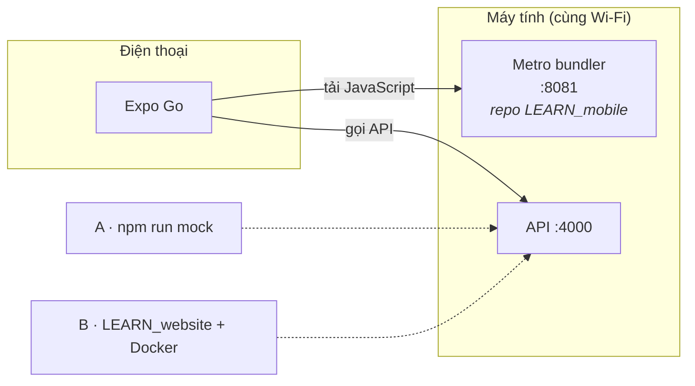

# Bắt đầu: cài đặt và chạy app

Hướng dẫn từ máy trống đến lúc đăng nhập được vào app. Làm đúng thứ tự; mỗi bước có cách kiểm tra
để biết đã xong.

**Mục lục:** [1. Cần hiểu trước](#1-cần-hiểu-trước) ·
[2. Yêu cầu](#2-yêu-cầu-môi-trường) ·
[3A. API mock](#3a-cách-a--chạy-api-mock-nhanh-nhất) ·
[3B. Backend thật](#3b-cách-b--dựng-backend-thật-repo-learn_website) ·
[4. Chạy app](#4-chạy-app-mobile-repo-này) ·
[5. Dùng thử](#5-dùng-thử-luồng-cơ-bản) ·
[6. Tài khoản](#6-tài-khoản-thử-nghiệm) ·
[7. Cấu hình thêm](#7-các-tình-huống-cần-cấu-hình-thêm) ·
[8. Sự cố](#8-xử-lý-sự-cố)

---

## 1. Cần hiểu trước

LEARN Mobile **không có backend riêng**. Mọi dữ liệu (đăng nhập, khóa học, bài học, kết quả làm bài)
đi qua một API. Bạn chọn một trong hai cách dựng API đó:

| Cách | Khi nào dùng | Cần gì |
| --- | --- | --- |
| **A. API mock** *(có sẵn trong repo)* | Làm giao diện, thử luồng, demo. **Khuyến nghị cho người mới.** | Chỉ Node |
| **B. Backend thật** ([LEARN_website](https://github.com/TrKimHieu/LEARN_website)) | Kiểm tra tích hợp thật, sinh bài bằng AI thật | Docker + clone repo LEARN_website |



> [!NOTE]
> Cả hai cách đều lắng nghe ở **cổng 4000**, nên app không cần đổi cấu hình khi chuyển qua lại.

## 2. Yêu cầu môi trường

| Thứ cần có | Ghi chú |
| --- | --- |
| Node.js ≥ 20 và npm | Kiểm tra: `node -v` |
| Git | |
| Docker Desktop | **Chỉ cho cách B.** Phải đang mở trước khi chạy `docker compose` |
| Expo Go (điện thoại) | Bản hỗ trợ **SDK 57**, cài từ App Store / Google Play |
| Cùng mạng Wi‑Fi | Điện thoại và máy tính phải chung một mạng |

Có thể thay điện thoại bằng trình giả lập Android (Android Studio) hoặc iOS Simulator (chỉ macOS).

## 3A. Cách A — chạy API mock (nhanh nhất)

Trong thư mục LEARN_mobile:

```bash
npm install
npm run mock
```

Terminal in ra địa chỉ API (cổng 4000) và tài khoản. **Để terminal này chạy liên tục.** Dữ liệu mẫu,
cách thử trạng thái lỗi và các biến cấu hình: [mock-api/README.md](../mock-api/README.md).

 **Kiểm tra:** mở `http://localhost:4000/api/v1/health` trên trình duyệt máy tính; phải thấy
`{"status":"ok","mock":true}`.

Xong thì chuyển sang [mục 4](#4-chạy-app-mobile-repo-này), bỏ qua 3B.

## 3B. Cách B — dựng backend thật (repo LEARN_website)

> [!IMPORTANT]
> Đặt repo này **cạnh** thư mục LEARN_mobile, tên thư mục là `LEARN`. Script đồng bộ contracts của
> app mobile tìm backend ở `../LEARN`.

```bash
git clone https://github.com/TrKimHieu/LEARN_website.git ../LEARN
cd ../LEARN
cp .env.example .env              # PowerShell: Copy-Item .env.example .env
npm install
docker compose -f infra/docker-compose.yml up -d
npm run db:migrate
npm run db:seed
```

| Lệnh | Việc làm |
| --- | --- |
| `docker compose … up -d` | Chạy ngầm 3 container: **Postgres 16** (dữ liệu), **Redis 7** (hàng đợi job AI), **MinIO** (kho lưu tài liệu, giống S3). `minio-init` chạy một lần để tạo bucket. |
| `npm run db:migrate` | Tạo các bảng trong Postgres. |
| `npm run db:seed` | Tạo dữ liệu mẫu, gồm tài khoản demo và admin ([mục 6](#6-tài-khoản-thử-nghiệm)). |

Sau đó mở **hai terminal** và để chúng chạy liên tục:

```bash
npm run dev:api       # terminal 1 — API ở cổng 4000
npm run dev:worker    # terminal 2 — worker sinh bài học bằng AI
```

> [!WARNING]
> Thiếu worker thì khi bấm "Sinh bài học", job treo mãi ở trạng thái chờ.

**AI giả hay AI thật?** File `.env` của LEARN mặc định `LLM_MODE=mock`: worker trả nội dung mẫu,
không gọi mạng và **không cần API key**. Chỉ khi muốn sinh bài bằng mô hình thật mới đặt
`LLM_MODE=live` và điền `LLM_API_KEY`.

 **Kiểm tra:** mở `http://localhost:4000/api/v1/health` trên trình duyệt máy tính; API phải trả về
trạng thái hoạt động.

## 4. Chạy app mobile (repo này)

Mở terminal mới (API ở mục 3 vẫn đang chạy), trong thư mục LEARN_mobile:

```bash
npm install     # bỏ qua nếu đã chạy ở bước 3A
npm start
```

`npm start` chạy `expo start`, tức **Metro bundler** ở cổng 8081 và in mã QR. Lệnh này **không** tự
mở trình duyệt hay trình giả lập.

| Thiết bị | Cách mở |
| --- | --- |
|  Android thật | Mở Expo Go → *Scan QR code* → quét mã |
|  iPhone thật | Mở app Camera → quét mã → mở bằng Expo Go |
| Trình giả lập Android | Trong terminal đang chạy Metro, bấm phím `a` |
| iOS Simulator (macOS) | Bấm phím `i` |
|  Trình duyệt (xem nhanh) | Bấm phím `w`, hoặc `npm run web` |

> [!NOTE]
> Bản web chỉ để xem nhanh lúc phát triển: phiên đăng nhập không được lưu, tải lại trang là phải
> đăng nhập lại.

**Địa chỉ API** được app tự suy từ máy đang chạy Metro: nếu Metro ở `192.168.1.20:8081` thì API là
`http://192.168.1.20:4000`. Chỉ cần cấu hình tay trong các trường hợp ở [mục 7](#7-các-tình-huống-cần-cấu-hình-thêm).

## 5. Dùng thử luồng cơ bản

1. Đăng nhập bằng tài khoản demo.
2. Tab **Khóa học** → tạo khóa học mới.
3. Vào khóa học → tải tài liệu lên (PDF, DOCX, PPTX, TXT, MD; tối đa 25 MB). Trạng thái tự đổi sang
   "Đã trích xuất".
4. Bấm **Sinh bài học**, chọn độ khó, theo dõi tiến độ trực tiếp.
5. Mở một bài học, đọc nội dung, làm bài tập, nộp bài và xem lại kết quả.
6. Tab **Tiến trình** hiện lịch sử làm bài.

## 6. Tài khoản thử nghiệm

Dữ liệu seed của môi trường dev (giống nhau ở API mock và backend thật), không phải tài khoản thật:

| Vai trò | Email | Mật khẩu |
| --- | --- | --- |
| Người học | `demo@learn.ai` | `Demo@12345` |
| Quản trị *(có thêm tab Quản trị)* | `admin@learn.ai` | `Admin@12345` |

## 7. Các tình huống cần cấu hình thêm

<details>
<summary><b>Đặt địa chỉ API thủ công</b></summary>

Tạo file `.env` từ `.env.example` rồi điền:

```ini
EXPO_PUBLIC_API_URL=http://192.168.1.20:4000
```

> [!WARNING]
> Biến `EXPO_PUBLIC_*` được nhúng thẳng vào bundle, nên **không bao giờ để bí mật** ở đây.

Khởi động lại Metro sau khi đổi.
</details>

<details>
<summary><b>Tải tài liệu lên từ điện thoại (chỉ backend thật)</b></summary>

API mock tự xử lý việc này, không cần cấu hình. Với backend thật, tệp được tải thẳng lên MinIO bằng
presigned URL. URL này được ký kèm tên máy, nên phải ký bằng địa chỉ mà điện thoại tới được. Trong
`.env` của **LEARN**:

```ini
S3_PUBLIC_ENDPOINT=http://<IP LAN máy tính>:9000
```

rồi khởi động lại API. Nếu để `localhost`, điện thoại sẽ không tải lên được.
</details>

<details>
<summary><b>Mạng chặn kết nối LAN</b></summary>

```bash
npx expo start --tunnel
```

Khi đó điện thoại không còn cùng LAN với API, nên API cũng phải tới được qua mạng: đặt
`EXPO_PUBLIC_API_URL` bằng địa chỉ công khai của API.
</details>

## 8. Xử lý sự cố

| Triệu chứng | Nguyên nhân thường gặp | Cách xử lý |
| --- | --- | --- |
| "Không kết nối được máy chủ" | API chưa chạy, hoặc khác mạng | Kiểm tra `npm run mock` (hoặc `npm run dev:api`); điện thoại cùng Wi‑Fi; tường lửa Windows cho phép cổng 4000 và 8081 |
| Quét QR nhưng không mở | Expo Go khác SDK | Cập nhật Expo Go lên bản hỗ trợ SDK 57 |
| Job AI đứng ở "Đang chờ" | Chưa chạy worker, hoặc Redis chưa lên | Chạy `npm run dev:worker`; `docker ps` phải thấy Redis |
| Tải tài liệu lỗi *(backend thật)* | `S3_PUBLIC_ENDPOINT` còn là `localhost` | Xem [mục 7](#7-các-tình-huống-cần-cấu-hình-thêm). Dùng API mock thì không gặp lỗi này |
| `docker compose` báo không kết nối được daemon | Docker Desktop chưa mở | Mở Docker Desktop, đợi nó khởi động xong |
| Cổng 4000 hoặc 8081 đã bị dùng | Tiến trình cũ còn chạy | Tắt tiến trình cũ, hoặc đổi cổng (`npx expo start --port 8082`) |
| Màn "Có phiên bản mới" ở Tổng quan | App cũ hơn `MIN_MOBILE_VERSION` của máy chủ | Cập nhật app, hoặc hạ `MIN_MOBILE_VERSION` ở máy chủ khi dev |
| Đăng nhập báo lỗi sau khi reset DB | Phiên cũ trong SecureStore không còn hợp lệ | Đăng nhập lại; app tự xoá phiên hỏng |

Vẫn lỗi: chạy `npm run doctor` (kiểm tra thư viện có khớp SDK 57 không) và đọc `requestId` hiển thị
trên màn lỗi để tra log của API.
