# LEARN Mobile — Đặc tả yêu cầu cho các tính năng mới (SRS)

**Phiên bản:** 0.4 (bản nháp)
**Ngày:** 2026-10-04
**Trạng thái:** Chờ duyệt
**Đối tượng đọc:** dev team xây các tính năng mới; QA; chủ sản phẩm

---

## 1. Giới thiệu

### 1.1 Mục đích

LEARN Mobile đã có một nền móng chạy được: đăng nhập, tải tài liệu lên, sinh bài học từ tài liệu bằng AI, và làm trắc nghiệm. Tài liệu này đặc tả **phần sẽ xây thêm trên nền móng đó**. Người đọc chính là những người xây: họ cần biết nền móng có gì, nó đảm bảo điều gì, và mỗi tính năng mới phải làm gì, nối vào đâu.

Cấu trúc tài liệu:
- Mục 2 **mô tả** nền móng hiện có. Đó là mô tả, không phải danh sách việc cần làm.
- Mục 3 đến 8 là **yêu cầu cho phần xây mới**.
- Tài liệu đứng độc lập: người đọc không cần tài liệu nào khác để hiểu yêu cầu.

### 1.2 Phạm vi

**Trong phạm vi (việc phải xây):** năm tính năng mới.
- **STO:** lưu tài liệu chỉ trên thiết bị, trích xuất văn bản tại thiết bị.
- **SRS:** flashcard và ôn tập ngắt quãng.
- **POM:** phiên học Pomodoro.
- **ENG:** streak, XP, mục tiêu mỗi ngày, nhắc học.
- **SOC:** xếp hạng, bảng điểm, bạn bè.

**Ngoài phạm vi:**
- Việc viết lại hay sửa nền móng hiện có, trừ những điểm tích hợp nêu rõ ở mục 4.
- Máy chủ, API, worker AI, cơ sở dữ liệu của hệ thống LEARN. Tài liệu này chỉ nêu những gì mobile cần từ phía đó (mục 4 và Phụ lục A).
- Thanh toán thật; bảng quản trị người dùng, khóa học, gói đăng ký trên mobile.

### 1.3 Định nghĩa và viết tắt

- **Course (khóa học):** nhóm tài liệu và bài học của một người dùng.
- **Document (tài liệu):** tệp người dùng tải lên: PDF, TXT, MD, DOCX, PPTX, tối đa 25 MB.
- **Chunk:** đoạn văn bản cắt từ tài liệu, làm nguồn cho AI.
- **Lesson (bài học):** nội dung Markdown do AI sinh, có thể sửa tay.
- **AI Job:** tiến trình nền ở máy chủ (trích xuất tài liệu, sinh bài học, sinh lại một bài).
- **SRS (Spaced Repetition System):** hệ thống ôn tập ngắt quãng.
- **XP:** điểm kinh nghiệm.
- **Contracts:** bộ định nghĩa dữ liệu (schema) dùng chung giữa máy chủ và các client.
- **Nền móng:** phần ứng dụng hiện có, mô tả ở mục 2.

### 1.4 Quy ước viết yêu cầu

**Mã yêu cầu:** `M-<NHÓM>-<SỐ>`, duy nhất trong tài liệu.

**Từ ngữ:** "phải" là bắt buộc; "nên" là khuyến nghị; "có thể" là tùy chọn.

**Ưu tiên (MoSCoW):**
- **Phải:** không có thì tính năng không dùng được hoặc vi phạm yêu cầu an toàn.
- **Nên:** quan trọng nhưng có cách thay thế tạm.
- **Có thể:** mong muốn, làm khi còn nguồn lực.

**Phương pháp kiểm chứng:**
- **T:** kiểm thử tự động (unit hoặc e2e).
- **M:** kiểm thử thủ công trên thiết bị thật.
- **I:** kiểm tra mã nguồn hoặc tài liệu thiết kế.

Giá trị ghi *đề xuất* do tài liệu này đề xuất và cần chủ sản phẩm xác nhận.

---

## 2. Nền móng hiện có (mô tả)

Mục này mô tả những gì đã có. Nó không chứa yêu cầu cần làm.

### 2.1 Ứng dụng hiện làm được gì

LEARN Mobile là app di động của hệ thống LEARN, chạy trên Android và iOS. Hiện nó làm được bốn việc cốt lõi:

1. **Đăng nhập:** đăng ký, đăng nhập, quên và đặt lại mật khẩu; giữ phiên giữa các lần mở app.
2. **Tải tài liệu lên:** người dùng tạo khóa học, chọn tệp (PDF, TXT, MD, DOCX, PPTX), tệp được tải lên kho lưu trữ của máy chủ, máy chủ trích xuất văn bản.
3. **Sinh bài học từ tài liệu bằng AI:** người dùng chọn độ khó, theo dõi tiến độ, nhận các bài học dạng Markdown kèm bài tập.
4. **Làm trắc nghiệm đơn giản:** người dùng làm bài tập của từng bài học, nộp, nhận điểm và lời giải thích do máy chủ chấm. Hiện hỗ trợ bốn dạng câu hỏi: chọn đáp án, đúng/sai, trả lời ngắn, điền chỗ trống.

Xung quanh bốn việc đó, app còn có các màn phụ trợ: tổng quan (học tiếp, vài số liệu), danh sách khóa học, tiến trình và lịch sử làm bài, cài đặt (giao diện, gói đăng ký), và bản quản trị rút gọn cho ADMIN.

App không có backend riêng: mọi dữ liệu đọc và ghi qua API của LEARN. Hiện chưa có chế độ ngoại tuyến.

**Mức độ kiểm chứng của nền móng:** đã kiểm bằng unit test (làm mới phiên, hàm định dạng, kiểm tra phiên bản, thành công một phần của AI Job) và e2e trên bản web. **Chưa** kiểm trên điện thoại thật. Người xây cần coi đây là rủi ro: lỗi trên máy thật ở nền móng có thể xuất hiện khi tính năng mới chạm vào nó.

### 2.2 Nền móng được tổ chức thế nào

Ba lớp, đi từ trên xuống:
- **Giao diện:** các màn hình và route; thành phần dùng chung (nút, thẻ, ô nhập, mascot, hiển thị Markdown); token màu sáng/tối.
- **Nghiệp vụ:** các module theo nghiệp vụ (đăng nhập, khóa học, tài liệu, học tập, AI, cài đặt, quản trị), mỗi module có các hook gọi API; một bộ nhớ đệm dữ liệu lo cache, hỏi lại định kỳ và làm mới khi quay lại app.
- **Hạ tầng:** máy khách API (gắn token, tự làm mới phiên), kho khoá của hệ điều hành, contracts.

Sơ đồ ở mục 9.2. Cây điều hướng ở mục 9.3.

### 2.3 Những điều nền móng đảm bảo và tính năng mới phải dùng lại

Đây là các quy ước đang có. Tính năng mới phải theo, không tự làm lại.

- **Phiên đăng nhập.** Refresh token nằm trong kho khoá của hệ điều hành; access token chỉ nằm trong bộ nhớ. Máy khách API tự gắn token và tự làm mới khi nhận 401, gộp mọi request cùng lỗi về một lượt làm mới. Tính năng mới gọi API qua máy khách này, không tự xử lý token.
- **Mất mạng khi mở app.** Nếu có phiên đã lưu mà không tới được máy chủ, app hiện màn "Không kết nối" và không đăng xuất.
- **Cách gọi API.** Mọi lời gọi qua máy khách API; lỗi trả về theo một dạng thống nhất kèm mã lỗi ổn định và mã yêu cầu. App xử lý theo mã lỗi, không theo chữ. Lỗi hạn mức (`QUOTA_EXCEEDED`, HTTP 402) mang chỉ số, giới hạn, đã dùng và đã có thông báo hạn mức dùng chung.
- **Năm trạng thái của màn hình.** Mọi màn có dữ liệu có đủ: đang tải, trống, lỗi (kèm nút thử lại và mã yêu cầu), một phần, thành công. Job AI đang chạy có thêm trạng thái thứ sáu: tiến độ.
- **Giao diện đơn sắc dịu.** Chỉ xám trung tính, không dùng cặp gần-trắng/gần-đen. Màu lấy từ token theo vai trò, trạng thái luôn kèm icon và chữ. Chữ nhỏ nhất 14 px; tương phản đạt WCAG; tôn trọng giảm chuyển động; có chế độ sáng/tối theo hệ thống hoặc chọn tay.
- **Bộ nhớ đệm dữ liệu.** Dữ liệu coi là còn mới trong 30 giây; không thử lại lỗi 4xx; lỗi khác thử lại tối đa 2 lần; quay lại foreground thì làm mới. Danh sách dài phân trang theo con trỏ.
- **Theo dõi tiến độ AI Job.** App hỏi lại mỗi 2 giây khi job đang chờ hoặc đang chạy, cho huỷ, và coi "thành công kèm lỗi một phần" là thành công một phần.
- **Tương thích với máy chủ.** App so dấu vân tay contracts và phiên bản app với máy chủ; app quá cũ thì hiện thông báo cập nhật. Contracts sinh tự động từ LEARN, không sửa tay trong app.
- **Phát hành.** Thư viện thêm bằng công cụ cài đặt của nền tảng để chọn đúng phiên bản; mã native không tạo hay sửa tay; thư viện có mã native không có trong Expo Go thì phải dùng development build.

### 2.4 Dữ liệu hiện có

Các thực thể do máy chủ LEARN sở hữu; app chỉ đọc và ghi qua API.

| Thực thể | Thuộc tính chính | Quan hệ |
| --- | --- | --- |
| User | id, email, tên hiển thị, vai trò (`LEARNER`/`ADMIN`), ngôn ngữ | sở hữu nhiều Course |
| Course | id, tên, mô tả, ngôn ngữ, trạng thái | có nhiều Document, nhiều Lesson |
| Document | id, tên tệp, MIME, kích thước, trạng thái (`PENDING`, `UPLOADED`, `EXTRACTING`, `EXTRACTED`, `FAILED`), số trang | thuộc một Course; có nhiều Chunk |
| Chunk | id, mã tài liệu, trang, đường dẫn tiêu đề, nội dung | thuộc một Document |
| Lesson | id, tiêu đề, tóm tắt, nội dung Markdown, thứ tự, trạng thái, `confidence`, các chunk nguồn | thuộc một Course; tham chiếu nhiều Chunk; có nhiều Exercise |
| Exercise, Question, AnswerOption | độ khó, điểm đạt; loại câu hỏi, đề, điểm; lựa chọn | Exercise thuộc một Lesson |
| Submission | lần làm, điểm, đạt hay không, thời gian làm | thuộc một User và một Exercise |
| LessonProgress | trạng thái (`NOT_STARTED`/`IN_PROGRESS`/`COMPLETED`), điểm cao nhất | thuộc một User và một Lesson |
| AIJob, GenerationRun | loại, trạng thái (`QUEUED`, `RUNNING`, `SUCCEEDED`, `FAILED`, `CANCELLED`), tiến độ; model, token, độ trễ | AIJob thuộc một Course |
| Plan, Subscription | mã gói, trạng thái, mức dùng | Subscription thuộc một User |

Sơ đồ thực thể ở mục 9.13.

Máy chủ đã có **chuỗi ngày học cơ bản** (`activeStreak`) và mobile hiển thị con số này ở tab Tổng quan. ENG sẽ mở rộng nó.

### 2.5 Giao diện API hiện có

Mọi request gửi header `x-learn-client: native`.

| Nhóm | Phương thức và đường dẫn |
| --- | --- |
| Xác thực | `POST /api/v1/auth/login`, `register`, `refresh`, `logout`, `logout-all`, `forgot-password`, `reset-password` |
| Khóa học | `GET /api/v1/workspace`, `POST /api/v1/courses`, `GET /api/v1/courses/:id` |
| Tài liệu | `POST /api/v1/courses/:id/documents/upload-url`, `PUT <presigned URL>`, `POST /api/v1/documents/:id/confirm`, `GET /api/v1/courses/:id/documents` |
| AI | `POST /api/v1/ai/courses/:id/generate-lessons`, `GET /api/v1/ai/jobs/:id`, `POST /api/v1/ai/jobs/:id/cancel` |
| Bài học | `GET /api/v1/courses/:id/lessons`, `GET`/`PATCH`/`DELETE .../lessons/:lessonId`, `GET .../sources`, `POST .../start`, `PATCH .../lessons/reorder` |
| Bài tập | `GET /api/v1/lessons/:lessonId/exercise`, `POST /api/v1/lessons/:lessonId/exercise/submit` |
| Tiến trình | `GET /api/v1/progress/overview`, `/courses`, `/history?limit=&cursor=` |
| Gói đăng ký | `GET /api/v1/plans`, `GET /api/v1/subscription`, `POST .../checkout`, `POST .../cancel` |
| Quản trị | `GET /api/v1/admin/metrics`, `GET /api/v1/admin/ai-jobs`, `GET .../ai-jobs/:id`, `.../audit-log`, `POST .../retry` |
| Meta | `GET /api/v1/meta` (phiên bản API, dấu vân tay contracts, phiên bản app tối thiểu) |

Mã lỗi ổn định: `VALIDATION_FAILED`, `UNAUTHENTICATED`, `FORBIDDEN`, `NOT_FOUND`, `CONFLICT`, `PAYLOAD_TOO_LARGE`, `UNSUPPORTED_FILE_TYPE`, `QUOTA_EXCEEDED`, `RATE_LIMITED`, `AI_GENERATION_FAILED`, `AI_GENERATION_TIMEOUT`, `UPSTREAM_UNAVAILABLE`, `INTERNAL_ERROR`.

---

## 3. Mô tả tổng quan phần xây mới

### 3.1 Người dùng

- **LEARNER:** người học; dùng toàn bộ tính năng mới.
- **ADMIN:** dùng như LEARNER; không có tính năng mới riêng.

### 3.2 Môi trường vận hành

- Android và iOS, màn hình dọc, từ 320 px chiều rộng.
- Chạy trong Expo Go nếu chỉ dùng thư viện có sẵn trong Expo Go, hoặc development build/APK khi cần mã native (khả năng cao với STO và thông báo).
- Cần mạng để đồng bộ. SRS và POM phải chịu được mất mạng giữa chừng (mục 6.5).

### 3.3 Thứ tự phát hành gợi ý

SRS, rồi POM, rồi ENG, rồi SOC. STO đi song song vì là thay đổi kiến trúc độc lập và có rủi ro cao nhất.

### 3.4 Giả định và phụ thuộc

- **A-01.** Máy chủ LEARN (API và worker) chạy và tới được từ thiết bị.
- **A-02.** Nhà cung cấp LLM khả dụng; hạn mức do máy chủ quản lý.
- **D-01.** Mọi tính năng mới cần thay đổi phía LEARN (contracts, endpoint, bảng dữ liệu). Mỗi tính năng ở mục 4 có phần "Phụ thuộc phía LEARN"; tổng hợp ở Phụ lục A.
- **D-02.** Thông báo cục bộ (POM, ENG) và trích xuất PDF trên máy (STO) phụ thuộc thư viện chưa được xác minh với phiên bản nền tảng đang dùng (Expo SDK 57).
- **D-03.** ENG phụ thuộc SRS và POM (hoạt động tính vào ngày học); SOC phụ thuộc ENG (xếp hạng theo XP).

### 3.5 Kịch bản sử dụng

**UC-01. Thêm tài liệu lưu trên máy** (STO).
Luồng chính: chọn tệp; app sao tệp vào bộ nhớ riêng và trích xuất văn bản tại máy; gửi văn bản lên máy chủ; sinh bài học như cũ.
Luồng thay thế: trích xuất thất bại hoặc loại tệp chưa hỗ trợ thì báo lỗi và không gửi gì lên máy chủ; sang máy khác thì thấy "Tệp gốc không còn trên máy này" nhưng bài học vẫn còn.

**UC-02. Ôn thẻ đến hạn** (SRS).
Luồng chính: mở "Ôn hôm nay"; xem mặt trước; lật thẻ; chấm Lại/Khó/Tốt/Dễ; kết thúc phiên; hệ thống lên lịch ôn lần sau.
Luồng thay thế: mất mạng giữa phiên thì kết quả được giữ và đồng bộ sau.

**UC-03. Học theo Pomodoro** (POM).
Luồng chính: bắt đầu phiên từ một bài học; học hết chu kỳ; nhận thông báo; nghỉ; lặp lại.
Luồng thay thế: từ chối quyền thông báo thì phiên vẫn chạy trong app; tắt hẳn app giữa chu kỳ rồi mở lại thì thời gian còn lại vẫn đúng.

**UC-04. Theo dõi streak, XP và mục tiêu ngày** (ENG).
Luồng chính: đặt mục tiêu ngày; hoàn thành hoạt động; thấy XP và chuỗi ngày cập nhật; nhận nhắc học nếu hôm nay chưa đạt mục tiêu.

**UC-05. Kết bạn và xem xếp hạng** (SOC).
Luồng chính: mời bạn bằng mã hoặc email; bạn chấp nhận; xem bảng xếp hạng tuần theo XP.
Luồng thay thế: người dùng tắt hiển thị tên mình thì chỉ bạn bè thấy.

---

## 4. Yêu cầu chức năng

Mỗi bảng có các cột: **Mã**, **Yêu cầu**, **Ưu tiên**, **Kiểm chứng**.

### 4.1 STO — Lưu tài liệu chỉ trên thiết bị

**Quyết định đã chốt:** tệp gốc chỉ lưu trong bộ nhớ của thiết bị; việc trích xuất văn bản diễn ra trên thiết bị; máy chủ chỉ nhận văn bản. Mục đích: giảm khối lượng lưu trữ cloud.

**Điểm tích hợp với nền móng:** thay luồng tải lên hiện tại (xin đường dẫn có chữ ký, PUT lên kho, xác nhận, máy chủ trích xuất) bằng luồng mới cho tài liệu lưu trên máy; giữ nguyên bước sinh bài học và khối "Nguồn" của bài học (vẫn dựa trên chunk ở máy chủ).

| Mã | Yêu cầu | Ưu tiên | Kiểm chứng |
| --- | --- | --- | --- |
| M-STO-01 | App phải sao tệp đã chọn vào thư mục riêng của app, đặt tên theo mã tài liệu, và giữ chỉ mục cục bộ gồm mã tài liệu, tên, kích thước, SHA-256, đường dẫn. | Phải | T, M |
| M-STO-02 | App phải trích xuất văn bản từ TXT và MD trên thiết bị. | Phải | T |
| M-STO-03 | App nên trích xuất văn bản từ DOCX và PPTX trên thiết bị. | Nên | T, M |
| M-STO-04 | App nên trích xuất văn bản từ PDF trên thiết bị nếu thử nghiệm khả thi (M-STO-09) đạt; nếu không đạt, phải ghi rõ PDF không được hỗ trợ trong chế độ này. | Nên | T, M |
| M-STO-05 | Sau khi trích xuất, app phải gửi văn bản và metadata (mã tài liệu, tên, số trang, SHA-256) lên máy chủ và không được tải tệp lên kho lưu trữ. | Phải | T |
| M-STO-06 | Khi thiết bị không còn giữ tệp gốc (gỡ app, đổi máy, bị xóa), app phải hiện trạng thái "Tệp gốc không còn trên máy này"; bài học và văn bản đã trích xuất phải không bị ảnh hưởng. | Phải | M |
| M-STO-07 | App nên cho gắn lại tệp gốc và kiểm bằng SHA-256 trước khi chấp nhận. | Nên | T, M |
| M-STO-08 | App phải có màn quản lý dung lượng: tổng dung lượng tài liệu trên máy, xóa từng tệp. Xóa tệp trên máy không được xóa bài học. | Phải | M |
| M-STO-09 | Trước khi cam kết hỗ trợ PDF, team phải làm thử nghiệm khả thi trên tối thiểu 5 PDF thật (có tiếng Việt có dấu, nhiều cột, bảng), đo thời gian và RAM trên máy Android tầm thấp. Ngưỡng đạt (*đề xuất*): văn bản đọc được và đủ để AI sinh bài, dưới 30 giây cho PDF 50 trang, không treo giao diện. | Phải | I, M |
| M-STO-10 | Tài liệu đã tải lên máy chủ theo luồng cũ phải giữ nguyên; app nên cho tuỳ chọn "Tải về máy" và không được ép di chuyển. | Nên | M |

**Phụ thuộc phía LEARN:** endpoint mới nhận văn bản đã trích xuất. Vì máy chủ không còn tệp nên không kiểm được loại tệp thật (magic bytes); bù bằng giới hạn kích thước văn bản, làm sạch nội dung và chống trùng bằng SHA-256 trong cùng khóa học. Hạn mức tài liệu phải tính lại theo văn bản. Cần một quyết định kiến trúc được ghi lại.

**Rủi ro:** PDF trích xuất trên máy có thể không đủ chất lượng; mất máy hoặc gỡ app là mất tệp gốc; tải nhiều tệp lớn làm đầy bộ nhớ máy.

**Nghiệm thu:**
- [ ] Chọn tệp TXT/MD/DOCX/PPTX rồi sinh được bài học mà không có yêu cầu tải tệp lên kho lưu trữ.
- [ ] Bài học sinh từ tài liệu trên máy vẫn hiện đúng khối "Nguồn".
- [ ] Gỡ app, cài lại, đăng nhập: bài học còn, tệp gốc báo "không còn trên máy này".
- [ ] Màn dung lượng hiển thị đúng và xóa được tệp.
- [ ] Kết quả thử nghiệm khả thi PDF được ghi lại và chốt phương án (có hoặc không hỗ trợ PDF).

### 4.2 SRS — Flashcard và ôn tập ngắt quãng

**Mục tiêu:** giúp người học nhớ lâu theo đường cong quên lãng bằng cách lên lịch ôn đúng lúc.

**Điểm tích hợp với nền móng:** sinh thẻ từ bài học dùng lại cơ chế AI Job (theo dõi tiến độ, huỷ, hạn mức); phiên ôn là một màn mới, có thể mở từ tab Tổng quan và từ màn bài học.

| Mã | Yêu cầu | Ưu tiên | Kiểm chứng |
| --- | --- | --- | --- |
| M-SRS-01 | Hệ thống phải sinh flashcard (mặt trước, mặt sau) từ một bài học bằng AI; thao tác này tính vào chi phí LLM và hạn mức. | Phải | T, M |
| M-SRS-02 | App phải cho người dùng sửa, thêm, xóa thẻ. | Phải | M |
| M-SRS-03 | Sau mỗi thẻ, app phải cho người học tự chấm độ nhớ theo bốn mức: Lại, Khó, Tốt, Dễ. | Phải | M |
| M-SRS-04 | Hệ thống phải lên lịch ôn lần sau bằng thuật toán **SM-2** (*đề xuất*; có thể nâng lên FSRS sau khi có đủ dữ liệu). Thuật toán phải có unit test với bộ ví dụ cố định. | Phải | T |
| M-SRS-05 | App phải có màn "Ôn hôm nay" liệt kê số thẻ đến hạn theo khóa, và phiên ôn đi tuần tự từng thẻ với thanh tiến độ. | Phải | M |
| M-SRS-06 | "Đến hạn" phải tính theo cùng múi giờ với chuỗi ngày học của máy chủ (mặc định giờ Việt Nam). | Phải | T |
| M-SRS-07 | Kết quả ôn không được mất khi mất mạng giữa phiên; app phải lưu cục bộ và đồng bộ khi có mạng. | Phải | T, M |

**Phụ thuộc phía LEARN:** contracts `Card`, `CardReview` và trạng thái lịch ôn (`dueAt`, `intervalDays`, `easeFactor`, `repetitions`); AI Job mới sinh thẻ; endpoint danh sách thẻ đến hạn và ghi kết quả ôn.

**Nghiệm thu:**
- [ ] Sinh được thẻ từ một bài học và sửa được thẻ.
- [ ] Chấm "Tốt" nhiều lần liên tiếp thì khoảng cách ôn tăng dần đúng công thức SM-2 (có unit test).
- [ ] Chấm "Lại" đưa thẻ về lịch ôn ngắn.
- [ ] Tắt mạng giữa phiên ôn: kết quả được giữ và đồng bộ lại.

### 4.3 POM — Phiên học Pomodoro

**Mục tiêu:** giúp người học tập trung theo chu kỳ học–nghỉ, gắn với bài học hoặc phiên ôn thẻ.

**Điểm tích hợp với nền móng:** mở được từ màn đọc bài; thời gian học ghi nhận theo khóa và bài; số liệu hiện ở tab Tiến trình.

| Mã | Yêu cầu | Ưu tiên | Kiểm chứng |
| --- | --- | --- | --- |
| M-POM-01 | App phải cho chạy phiên học theo chu kỳ. Mặc định (*đề xuất*): học 25 phút, nghỉ 5 phút; sau 4 chu kỳ nghỉ dài 15 phút. Người dùng phải chỉnh được các thời lượng. | Phải | M |
| M-POM-02 | Người dùng nên bắt đầu được phiên từ một bài học hoặc từ phiên ôn SRS; thời gian học phải ghi nhận theo khóa và bài. | Nên | M |
| M-POM-03 | Đồng hồ phải tính theo mốc thời gian thực (thời điểm bắt đầu và kết thúc), không dựa bộ đếm chạy nền, để đúng khi app bị tạm dừng hoặc bị hệ điều hành đóng. | Phải | T, M |
| M-POM-04 | Khi hết chu kỳ, app phải gửi thông báo cục bộ kể cả khi app ở nền. Nếu người dùng từ chối quyền thông báo, phiên vẫn phải chạy trong app và app phải nhắc bật quyền. | Phải | M |
| M-POM-05 | Thoát giữa chu kỳ phải có xác nhận; app nên cho tạm dừng và tiếp tục. | Nên | M |
| M-POM-06 | Tab Tiến trình có thể hiện thống kê thời gian học theo ngày. | Có thể | M |

**Phụ thuộc kỹ thuật:** thông báo cục bộ; cần xác minh thư viện có chạy trong Expo Go hay buộc dùng development build. Dữ liệu thời gian học có thể lưu cục bộ trước, đồng bộ lên máy chủ khi ENG cần.

**Nghiệm thu:**
- [ ] Đặt giờ, đưa app xuống nền, đúng giờ nhận thông báo.
- [ ] Tắt hẳn app giữa chu kỳ, mở lại: thời gian còn lại đúng theo giờ thực.
- [ ] Từ chối quyền thông báo: app không lỗi, hiện lời nhắc bật quyền.

### 4.4 ENG — Streak, XP, mục tiêu mỗi ngày, nhắc học

**Mục tiêu:** giữ thói quen học (kiểu Duolingo).

**Điểm tích hợp với nền móng:** mở rộng chuỗi ngày học `activeStreak` sẵn có của máy chủ và số liệu "Chuỗi ngày học" ở tab Tổng quan; thêm vòng tiến độ mục tiêu ngày vào tab Tổng quan.

| Mã | Yêu cầu | Ưu tiên | Kiểm chứng |
| --- | --- | --- | --- |
| M-ENG-01 | Một ngày phải được tính là "đã học" khi có ít nhất một hoạt động hợp lệ: hoàn thành bài học, nộp bài tập, hoặc hoàn thành một phiên ôn SRS. Ranh giới ngày theo múi giờ cấu hình ở máy chủ. | Phải | T |
| M-ENG-02 | XP phải do **máy chủ** tính từ sự kiện đã xác thực; client chỉ hiển thị và không được tự cộng. Bảng XP cụ thể là *đề xuất*, cần chủ sản phẩm xác nhận. | Phải | T |
| M-ENG-03 | Người dùng phải chọn được mục tiêu mỗi ngày; tab Tổng quan phải hiện tiến độ trong ngày. | Phải | M |
| M-ENG-04 | App nên nhắc học bằng thông báo cục bộ vào giờ người dùng chọn, và chỉ nhắc khi hôm nay chưa đạt mục tiêu. | Nên | M |
| M-ENG-05 | App có thể cảnh báo khi chuỗi ngày sắp đứt. | Có thể | M |

**Phụ thuộc phía LEARN:** sự kiện XP, mục tiêu ngày, cấu hình nhắc; mở rộng chuỗi ngày học để tính thêm ôn SRS và phiên Pomodoro.

**Nghiệm thu:**
- [ ] Hoàn thành một hoạt động thì XP và chuỗi ngày cập nhật đúng trong cùng ngày.
- [ ] Đạt mục tiêu ngày thì vòng tiến độ đầy và nhắc học hôm đó bị bỏ.
- [ ] Gửi XP giả từ client không làm đổi XP trên máy chủ.

### 4.5 SOC — Xếp hạng, bảng điểm, bạn bè

**Mục tiêu:** tạo động lực thi đua lành mạnh.

**Điểm tích hợp với nền móng:** thêm màn bạn bè và xếp hạng (mở từ tab Tiến trình); xếp hạng dựa trên XP của ENG. Đây là nhóm lớn nhất, làm sau cùng.

| Mã | Yêu cầu | Ưu tiên | Kiểm chứng |
| --- | --- | --- | --- |
| M-SOC-01 | App phải cho kết bạn bằng mã mời hoặc email; chấp nhận, từ chối, huỷ kết bạn. | Phải | T, M |
| M-SOC-02 | App nên hiện bảng xếp hạng tuần theo XP trong nhóm bạn bè; league theo nhóm người dùng (reset đầu tuần) là *đề xuất*. | Nên | M |
| M-SOC-03 | Người dùng phải chọn được việc có hiện tên mình trên bảng xếp hạng hay không; mặc định chỉ bạn bè thấy. | Phải | T, M |
| M-SOC-04 | Xếp hạng phải chỉ dựa trên XP do máy chủ tính (M-ENG-02) và có giới hạn XP tối đa mỗi ngày để chặn gian lận. | Phải | T |
| M-SOC-05 | Hệ thống không được để lộ email, lịch sử học hay nội dung khóa học của một người cho người không phải bạn bè. | Phải | T |
| M-SOC-06 | Máy chủ phải giới hạn tần suất lời mời kết bạn. | Phải | T |

**Phụ thuộc phía LEARN:** bảng bạn bè, lời mời, league, điểm tuần; kiểm quyền sở hữu dữ liệu ở tầng truy cập dữ liệu; phụ thuộc ENG.

**Nghiệm thu:**
- [ ] Mời và chấp nhận bạn bè giữa hai tài khoản.
- [ ] Bảng xếp hạng chỉ hiện người đã đồng ý hiển thị.
- [ ] Người không phải bạn không đọc được dữ liệu học của người khác qua API.

---

## 5. Yêu cầu giao diện ngoài

### 5.1 Giao diện người dùng (áp dụng cho mọi màn mới)

| Mã | Yêu cầu | Ưu tiên | Kiểm chứng |
| --- | --- | --- | --- |
| M-UI-01 | Mọi màn mới có dữ liệu phải có đủ năm trạng thái: đang tải (skeleton đúng hình dạng nội dung), trống (mascot, câu giải thích, hành động), lỗi (theo mã lỗi, mã yêu cầu, nút thử lại), một phần, thành công. | Phải | M, T |
| M-UI-02 | Màn mới phải theo giao diện đơn sắc dịu của nền móng: chỉ xám trung tính, không cặp gần-trắng/gần-đen, màu lấy từ token theo vai trò (không hardcode). Sáng: nền `#f1f1f1`, chữ `#2b2b2b`, nút chính `#3d3d3d`. Tối: nền `#1c1c1c`, chữ `#e3e3e3`, nút chính `#cdcdcd`. | Phải | I |
| M-UI-03 | Trạng thái phải luôn kèm icon và chữ, không chỉ dựa vào màu. | Phải | M |
| M-UI-04 | Bàn phím không được che ô nhập; vùng an toàn không được bị tai thỏ hay thanh home che tiêu đề và thanh hành động. | Phải | M |
| M-UI-05 | Màn mới phải đúng ở chế độ sáng và tối, theo hệ thống hoặc chọn tay. | Phải | M |
| M-UI-06 | Màn lỗi phải hiện mã yêu cầu để người dùng đọc lại khi báo lỗi; không được hiện stack trace. | Phải | M |

### 5.2 Giao diện phần cứng và hệ điều hành

- **Bộ nhớ tệp riêng của app** (STO): thư mục riêng, không phải thư mục dùng chung.
- **Thông báo cục bộ** (POM, ENG): thư viện cần xác minh với phiên bản nền tảng đang dùng; cần xin quyền thông báo.
- **Trích xuất văn bản trên máy** (STO): với DOCX/PPTX có thể giải nén và đọc XML bằng thư viện JavaScript; với PDF cần thư viện chưa xác minh (xem M-STO-09).

### 5.3 Giao diện phần mềm: API mới đề xuất

Tên và dạng cụ thể do phía LEARN chốt; bảng này chỉ nêu nhu cầu của mobile.

| Tính năng | Nhu cầu |
| --- | --- |
| STO | Gửi văn bản đã trích xuất và metadata cho một tài liệu mới (thay luồng presigned URL cho tài liệu lưu trên máy) |
| SRS | Sinh thẻ từ một bài học (dạng AI Job); danh sách, sửa, thêm, xóa thẻ; lấy thẻ đến hạn; gửi lô kết quả ôn (chịu được gửi lặp) |
| POM | Ghi nhận phiên học (bắt đầu, kết thúc, bài học liên quan) khi ENG cần |
| ENG | Xem tiến độ hôm nay (XP, chuỗi ngày, mục tiêu); đặt mục tiêu ngày và giờ nhắc |
| SOC | Gửi, chấp nhận, từ chối lời mời kết bạn; danh sách bạn bè; bảng xếp hạng tuần; đặt chế độ hiển thị tên |

### 5.4 Giao diện truyền thông

| Mã | Yêu cầu | Ưu tiên | Kiểm chứng |
| --- | --- | --- | --- |
| M-COM-01 | Mọi lời gọi API mới phải đi qua máy khách API của nền móng (xem mục 2.3), không tự xử lý token hay tự làm mới phiên. | Phải | I |
| M-COM-02 | Các thao tác ghi do tính năng mới tạo khi mất mạng (kết quả ôn, thời gian học) phải gửi được lặp mà không làm trùng dữ liệu ở máy chủ. | Phải | T |
| M-COM-03 | Khi API đổi contract làm app cũ không chạy đúng, máy chủ tăng phiên bản app tối thiểu để app cũ nhận thông báo cập nhật. | Phải | M |

---

## 6. Yêu cầu phi chức năng (áp dụng cho mọi tính năng mới)

### 6.1 Hiệu năng

| Mã | Yêu cầu | Ưu tiên | Kiểm chứng |
| --- | --- | --- | --- |
| M-PERF-01 | Danh sách dài (thẻ, bạn bè, xếp hạng) phải phân trang theo con trỏ, không dùng offset. | Phải | T |
| M-PERF-02 | Màn đầu tiên phải tương tác được trong 3 giây sau khi mở app (đã đăng nhập, mạng tốt, thiết bị tầm trung). Giá trị là *đề xuất*. | Nên | M |
| M-PERF-03 | Mọi thao tác chạm phải có phản hồi hiển thị trong 100 ms. Giá trị là *đề xuất*. | Nên | M |
| M-PERF-04 | Trích xuất văn bản trên máy (STO) không được làm treo giao diện: phải chạy nền hoặc chia nhỏ, và hiện tiến độ. | Phải | M |
| M-PERF-05 | Dữ liệu nặng không cần ngay phải chỉ tải khi người dùng mở. | Nên | I |

### 6.2 Bảo mật và quyền riêng tư

| Mã | Yêu cầu | Ưu tiên | Kiểm chứng |
| --- | --- | --- | --- |
| M-SEC-01 | Phân quyền và tính toán điểm (XP, xếp hạng, lịch ôn) phải do máy chủ thực hiện; app chỉ hiển thị. | Phải | I, T |
| M-SEC-02 | Tệp lưu trên máy (STO) phải nằm trong thư mục riêng của app, không trong thư mục dùng chung. | Phải | I, M |
| M-SEC-03 | Khi đăng xuất, app phải xóa dữ liệu phiên. Chính sách đối với tệp đã lưu trên máy khi đăng xuất phải được chủ sản phẩm quyết định (xem Phụ lục B, câu 9). | Phải | M |
| M-SEC-04 | App không được ghi mật khẩu hoặc token vào log. Yêu cầu là *đề xuất*. | Nên | I |
| M-SEC-05 | Dữ liệu bạn bè và xếp hạng không được lộ thông tin riêng tư (xem M-SOC-05). | Phải | T |

### 6.3 Khả dụng và trợ năng

| Mã | Yêu cầu | Ưu tiên | Kiểm chứng |
| --- | --- | --- | --- |
| M-USE-01 | Tương phản văn bản phải đạt WCAG: chữ thường ≥ 4.5:1; viền ô nhập ≥ 3:1 trên nền bề mặt. | Phải | I, T |
| M-USE-02 | Chữ nhỏ nhất phải ≥ 14 px. | Phải | M |
| M-USE-03 | Hiệu ứng chuyển động (đồng hồ Pomodoro, vòng mục tiêu, lật thẻ) phải tôn trọng cài đặt giảm chuyển động của hệ thống. | Phải | M |
| M-USE-04 | TalkBack và VoiceOver phải đọc được các điều khiển chính của màn mới (lật thẻ, chấm độ nhớ, đồng hồ, bảng xếp hạng). | Phải | M |
| M-USE-05 | Vùng chạm tối thiểu nên là 44 pt (iOS) và 48 dp (Android). Giá trị là *đề xuất*. | Nên | M |

### 6.4 Tương thích

| Mã | Yêu cầu | Ưu tiên | Kiểm chứng |
| --- | --- | --- | --- |
| M-COMP-01 | App phải chạy trên các phiên bản Android và iOS tối thiểu mà nền tảng đang dùng (Expo SDK 57) hỗ trợ. Mức tối thiểu cụ thể phải được xác minh và ghi vào bản sau của tài liệu này. | Phải | I |
| M-COMP-02 | Tính năng nào cần mã native không có trong Expo Go phải được ghi rõ, và app phải chạy được bằng development build/APK. | Phải | I, M |
| M-COMP-03 | Màn mới phải hiển thị đúng ở khung dọc từ 320 px chiều rộng, không tràn ngang. | Phải | T, M |

### 6.5 Độ tin cậy và khả năng phục hồi

| Mã | Yêu cầu | Ưu tiên | Kiểm chứng |
| --- | --- | --- | --- |
| M-REL-01 | Dữ liệu ôn tập và thời gian học tạo khi không có mạng (SRS, POM) phải không bị mất và phải đồng bộ khi có mạng. | Phải | T, M |
| M-REL-02 | Đồng bộ lặp (gửi lại cùng một kết quả ôn) phải cho cùng một kết quả ở máy chủ. | Phải | T |
| M-REL-03 | Các tính toán theo ngày (đến hạn, chuỗi ngày, mục tiêu ngày) phải dùng cùng múi giờ với máy chủ, không dùng múi giờ máy khi hai múi giờ khác nhau. | Phải | T |
| M-REL-04 | Mất tệp gốc trên máy (STO) không được làm hỏng bài học hay màn đọc bài (xem M-STO-06). | Phải | M |

### 6.6 Khả năng bảo trì

| Mã | Yêu cầu | Ưu tiên | Kiểm chứng |
| --- | --- | --- | --- |
| M-MNT-01 | Mọi thay đổi phải qua kiểm tra mã (lint) và kiểm tra kiểu (typecheck) trước khi coi là xong. | Phải | T |
| M-MNT-02 | Contracts mới do LEARN cung cấp và được sinh tự động vào app; không được sửa tay trong app. Kiểm tra kiểu phải báo lệch với LEARN. | Phải | T |
| M-MNT-03 | Thư viện mới phải được thêm bằng công cụ cài đặt của nền tảng (`npx expo install`) để chọn đúng phiên bản tương thích. | Phải | I |
| M-MNT-04 | Trước khi dùng một API của nền tảng, dev phải xác minh API đó tồn tại và đúng ở phiên bản đang dùng, vì các API này thay đổi giữa các phiên bản. | Phải | I |
| M-MNT-05 | Thuật toán lên lịch (SM-2), tính ngày học và đồng hồ Pomodoro phải có unit test. | Phải | T |
| M-MNT-06 | Khi thêm hoặc đổi một màn người dùng hay một contract, phải cập nhật bảng đối chiếu tính năng giữa web và mobile. | Phải | I |

---

## 7. Mô hình dữ liệu cho phần xây mới

Thực thể mới; thực thể hiện có ở mục 2.4. Phần do máy chủ sở hữu sẽ do LEARN định nghĩa chính xác.

| Thực thể | Thuộc tính chính | Thuộc tính năng | Quan hệ với thực thể hiện có |
| --- | --- | --- | --- |
| LocalDocument (chỉ trên thiết bị) | mã tài liệu, tên, kích thước, SHA-256, đường dẫn | STO | tương ứng một Document |
| Card | id, mã bài học, mặt trước, mặt sau | SRS | thuộc một Lesson |
| CardSchedule | mã thẻ, hạn ôn, khoảng cách ngày, hệ số dễ, số lần lặp | SRS | một-một với Card |
| CardReview | mã thẻ, mức chấm (Lại/Khó/Tốt/Dễ), thời điểm ôn | SRS | thuộc một Card và một User |
| StudySession | id, bắt đầu, kết thúc, mã bài học hoặc phiên SRS | POM | thuộc một User; gắn với Lesson |
| XpEvent | mã người dùng, nguồn, giá trị, ngày | ENG | thuộc một User |
| DailyGoal | mã người dùng, loại mục tiêu, giá trị, giờ nhắc | ENG | thuộc một User |
| Friendship | hai người dùng, trạng thái | SOC | liên kết hai User |
| LeagueEntry | mã người dùng, tuần, XP | SOC | thuộc một User |

Sơ đồ thực thể ở mục 9.14.

---

## 8. Ma trận truy vết

| Kịch bản | Tính năng | Yêu cầu chính | Kiểm chứng chính |
| --- | --- | --- | --- |
| UC-01 Thêm tài liệu lưu trên máy | STO | M-STO-01 đến M-STO-10, M-SEC-02, M-REL-04 | Thử nghiệm khả thi PDF (M-STO-09); unit test trích xuất; thủ công gỡ và cài lại app |
| UC-02 Ôn thẻ đến hạn | SRS | M-SRS-01 đến M-SRS-07, M-REL-01, M-REL-02 | Unit test SM-2; thủ công tắt mạng giữa phiên |
| UC-03 Học theo Pomodoro | POM | M-POM-01 đến M-POM-06, M-USE-03 | Unit test đồng hồ; thủ công với app ở nền và tắt hẳn |
| UC-04 Theo dõi streak, XP, mục tiêu ngày | ENG | M-ENG-01 đến M-ENG-05, M-REL-03 | Unit test tính ngày; thủ công qua ranh giới ngày |
| UC-05 Kết bạn và xem xếp hạng | SOC | M-SOC-01 đến M-SOC-06, M-SEC-05 | Test truy cập dữ liệu giữa hai tài khoản |
| Xuyên suốt | Tất cả | M-UI-01 đến M-UI-06, M-PERF, M-USE, M-COMP, M-MNT | Thủ công trên thiết bị thật; axe trên bản web |

Nền móng hiện chưa được kiểm trên điện thoại thật (mục 2.1). Mỗi nghiệm thu thủ công ở mục 4 vì thế cũng là phép thử nền móng; lỗi phát hiện ở nền móng phải được ghi lại và xử lý riêng, không tính vào tính năng mới.

---

## 9. Sơ đồ

Các sơ đồ viết bằng Mermaid. Sơ đồ có phần `Dự kiến` đều được ghi chú ngay trong sơ đồ. Nếu sơ đồ và sản phẩm thực tế lệch nhau thì sản phẩm đúng, và sơ đồ phải được sửa.

### 9.1 Ngữ cảnh hệ thống

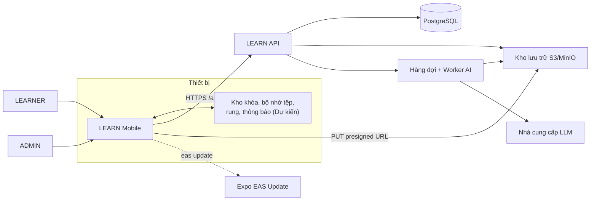

### 9.2 Kiến trúc phân lớp của nền móng

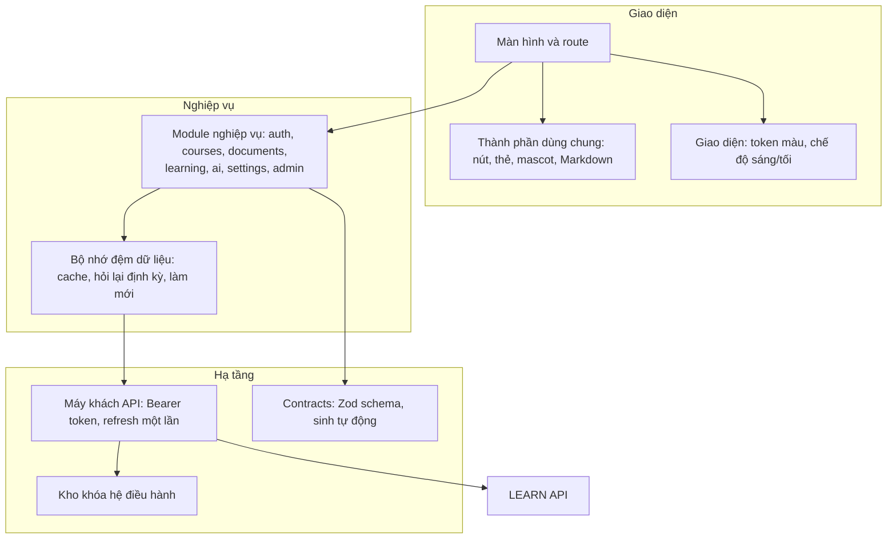

### 9.3 Sơ đồ điều hướng màn hình

Các màn có nhãn `Dự kiến` là màn mới.

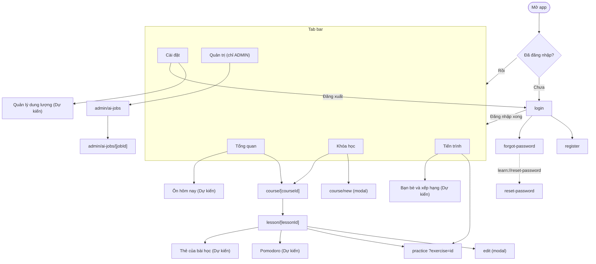

### 9.4 Sơ đồ ca sử dụng (phần xây mới)

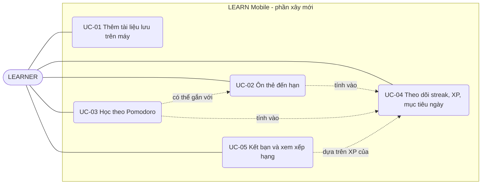

### 9.5 Tuần tự nền móng: duy trì phiên và làm mới token

Mọi lời gọi API của tính năng mới đi qua luồng này (M-COM-01).

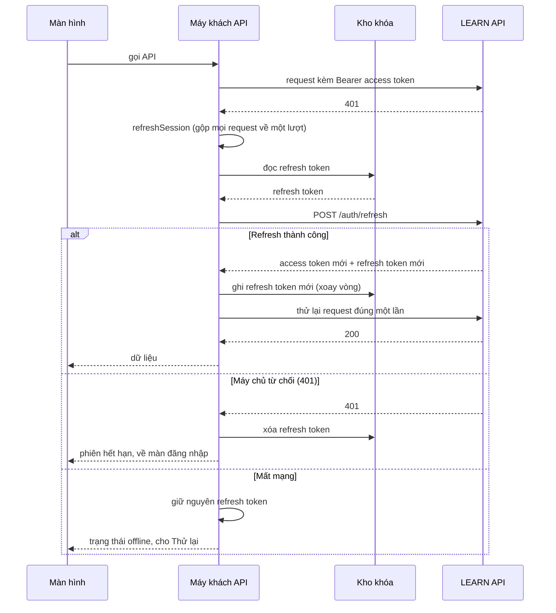

### 9.6 Tuần tự nền móng: tải tài liệu lên hiện tại (STO sẽ thay luồng này)

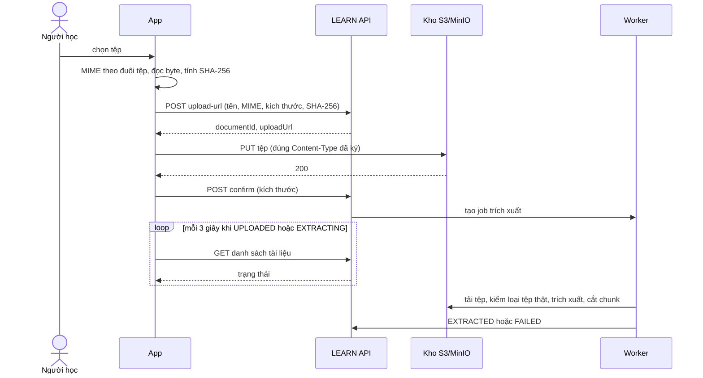

### 9.7 Tuần tự nền móng: sinh bài học bằng AI (SRS sinh thẻ dùng lại cơ chế này)

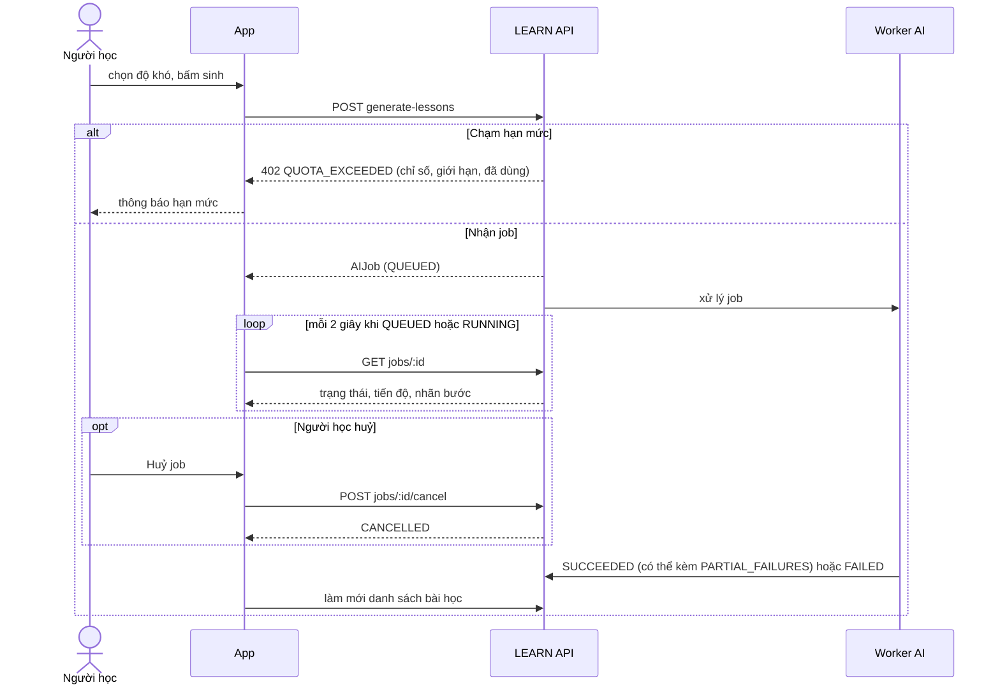

### 9.8 Tuần tự: thêm tài liệu lưu trên máy (STO, Dự kiến)

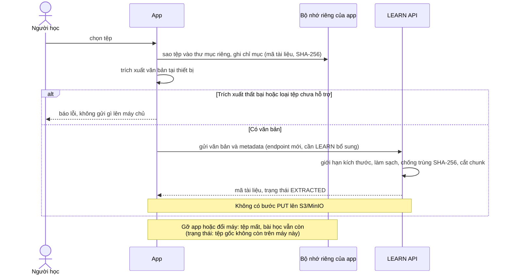

### 9.9 Tuần tự: ôn thẻ đến hạn (SRS, Dự kiến)

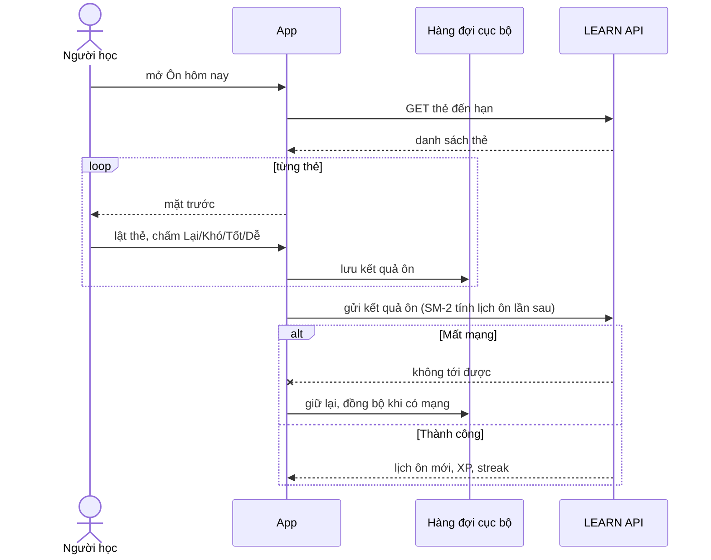

### 9.10 Máy trạng thái nền móng: tài liệu

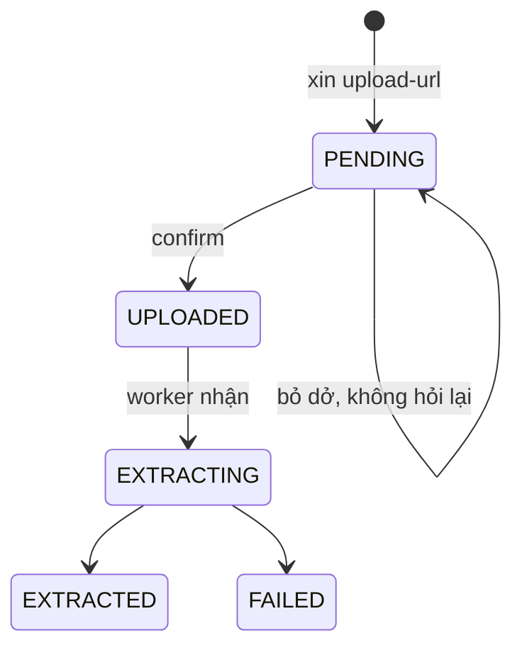

Ghi chú: bước `PENDING` sang `UPLOADED` suy ra từ luồng xác nhận tải lên; chuyển tiếp chính xác do máy chủ quyết định và cần đối chiếu với phía LEARN. Với tài liệu lưu trên máy (STO), trạng thái đi thẳng tới `EXTRACTED` khi máy chủ nhận văn bản; cách xử lý các trạng thái trung gian do phía LEARN chốt.

### 9.11 Máy trạng thái nền móng: AI Job

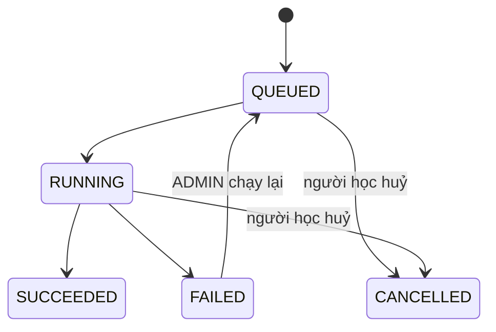

Ghi chú: `SUCCEEDED` có thể kèm lỗi `PARTIAL_FAILURES` và được coi là thành công một phần. Các chuyển tiếp suy ra từ hành vi của app, cần đối chiếu với phía LEARN.

### 9.12 Máy trạng thái: phiên Pomodoro (POM, Dự kiến)

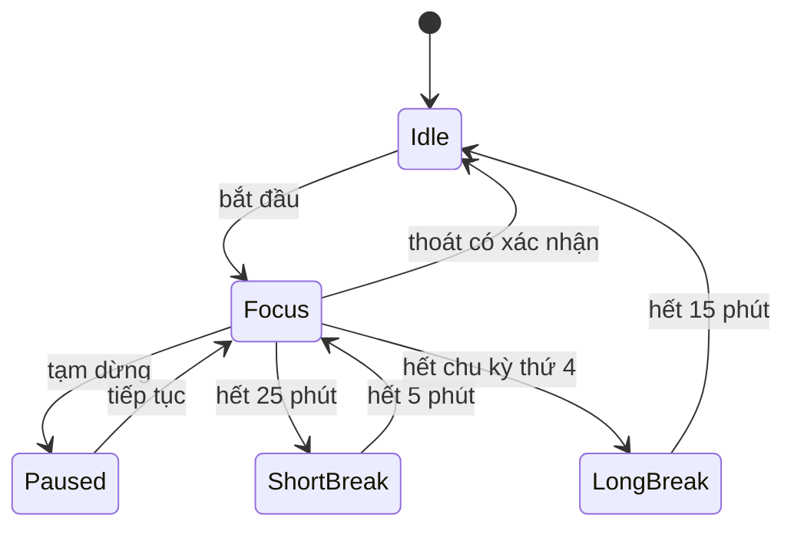

Ghi chú: các thời lượng là *đề xuất* (M-POM-01). Đồng hồ tính theo mốc thời gian thực (M-POM-03).

### 9.13 Sơ đồ thực thể: dữ liệu nền móng

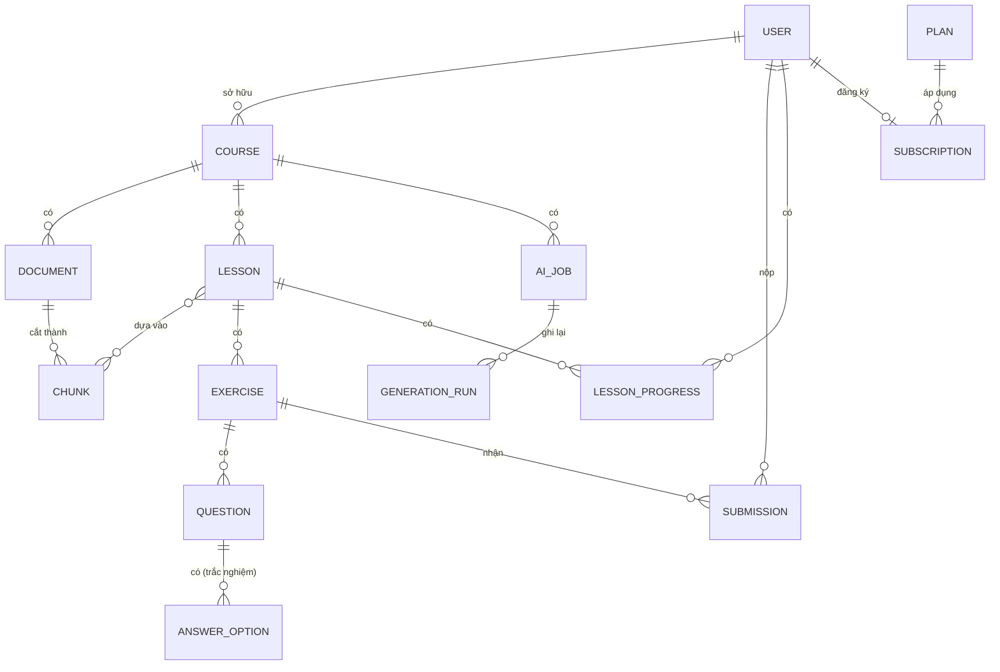

### 9.14 Sơ đồ thực thể: dữ liệu mới (Dự kiến)

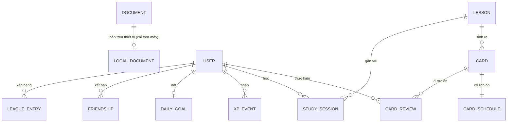

---

## Phụ lục A. Việc cần phía LEARN và thay đổi phạm vi MVP

Phạm vi MVP hiện tại của hệ thống LEARN loại trừ một số thứ mà năm tính năng mới cần. Nếu roadmap được duyệt, phạm vi của LEARN phải được cập nhật bởi người quản lý hệ thống đó. Tài liệu này không thay đổi gì bên LEARN.

**Phạm vi MVP đang loại trừ:**
- **Gamification phức tạp** (huy hiệu, streak nâng cao ngoài chuỗi ngày học cơ bản). Liên quan ENG, SOC.
- **Spaced repetition nâng cao.** Liên quan SRS.
- **Luồng tải tệp lên kho lưu trữ qua đường dẫn có chữ ký, và kiểm loại tệp thật ở worker,** sẽ không còn áp dụng cho tài liệu lưu trên máy. Liên quan STO.

**Việc backend theo từng tính năng:**
- **STO:** endpoint nhận văn bản đã trích xuất; làm sạch, giới hạn, chống trùng; tính lại hạn mức tài liệu.
- **SRS:** contracts và bảng cho thẻ, lịch ôn, kết quả ôn; AI Job sinh thẻ; endpoint thẻ đến hạn và ghi kết quả ôn (chịu gửi lặp).
- **POM:** ghi nhận phiên học khi ENG cần.
- **ENG:** sự kiện XP, mục tiêu ngày, cấu hình nhắc; mở rộng chuỗi ngày học.
- **SOC:** bạn bè, lời mời, league, điểm tuần; giới hạn tần suất lời mời; kiểm quyền dữ liệu.

**Quyết định kiến trúc cần ghi lại:** (1) lưu tệp và trích xuất trên thiết bị; (2) thuật toán SRS; (3) mô hình XP và chống gian lận.

## Phụ lục B. Câu hỏi mở

1. STO: PDF trích xuất trên máy có đủ chất lượng không, và chấp nhận việc bắt buộc dùng development build không? (kết quả M-STO-09 quyết định)
2. STO: Chunking làm ở client hay ở máy chủ?
3. SRS: Dùng SM-2 ngay hay chờ FSRS?
4. POM, ENG: Thông báo cục bộ có chạy trong Expo Go ở SDK 57 không, hay bắt buộc development build?
5. ENG: Bảng XP cụ thể và mục tiêu mặc định mỗi ngày là gì?
6. SOC: Quy mô league, quy tắc lên/xuống hạng; có cần kiểm duyệt tên hiển thị không?
7. Phạm vi: Chủ sản phẩm có chấp nhận đổi phạm vi MVP như Phụ lục A không, và ai phụ trách cập nhật phía LEARN?
8. Hạn mức: Gói đăng ký tính hạn mức cho thẻ SRS, dung lượng tài liệu trên máy và AI Job sinh thẻ như thế nào?
9. STO: Khi đăng xuất, tệp đã lưu trên máy có bị xóa không?
10. Tương thích: Phiên bản Android và iOS tối thiểu cụ thể (M-COMP-01) và ngưỡng hiệu năng (M-PERF-02, M-PERF-03) có được chủ sản phẩm chấp nhận không?

## Phụ lục C. Công nghệ của nền móng (tham khảo, không ràng buộc)

- **Nền tảng:** Expo SDK 57, React Native 0.86, React 19.2, TypeScript strict.
- **Điều hướng:** Expo Router, route theo tệp, typed routes, nhóm route được bảo vệ theo trạng thái đăng nhập.
- **Dữ liệu:** TanStack Query cho bộ nhớ đệm và hỏi lại định kỳ; Zod cho schema.
- **Phiên đăng nhập:** `expo-secure-store` cho refresh token.
- **Giao diện:** Hanken Grotesk, icon Phosphor, `react-native-svg` cho bìa khóa học và mascot Circle.
- **Tài liệu:** trình chọn tệp, hệ thống tệp, SHA-256 của Expo.
- **Kiểm thử:** Jest (jest-expo) cho unit test; Playwright và axe cho e2e trên bản web.
- **Phát hành (EAS):** ba profile `development` (development client, nội bộ), `preview` (kênh `preview`, APK), `production` (kênh `production`, tự tăng build). Phiên bản runtime theo phiên bản app: đổi thư viện native hoặc tăng phiên bản thì phải build lại; sửa giao diện thì chỉ cần cập nhật qua `eas update`.
- **Hạng mục còn thiếu của nền móng trước khi phát hành:** gắn `projectId` và địa chỉ cập nhật của EAS vào cấu hình app; chạy kiểm trên điện thoại thật (bàn phím, vùng an toàn, nút Back Android, tải tệp, chế độ tối, trình đọc màn hình, mất mạng khi mở app).
